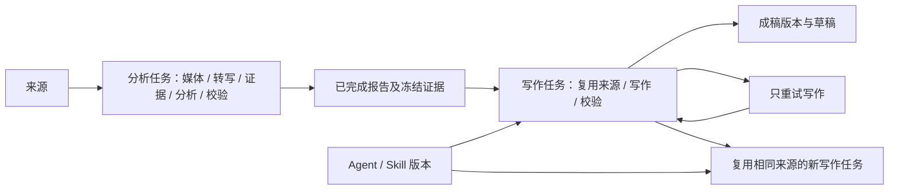

# 独立分析、写作与可扩展方法

2026-10-27。在本机实现并验证；不迁移或重写用户已有报告。

## 用户流程

1. AI 内容分析中“开始分析”只创建分析任务，保存拆解、评论理解、选题线索与引用；不自动生成稿件。
2. 完成后“用此报告创作”带入已保存结果。选择 Agent、Skill 与写作需求，再确认创建独立写作任务。
3. 写作直接使用任务冻结的报告、原文、评论和转写，不重新采集、准备媒体、转写或分析。
4. “复用相同来源再写一版”锁定已有写作的完整来源快照，只更新写作需求和方法版本。即使原数据库、上游报告后来变化，也不改用新数据。
5. 分析详情可打开基于它的写作任务；写作详情可返回来源任务。写作工作台另有持久任务记录、取消和“仅重试写作”。

采用、人工编辑、草稿版本、字幕制作和原视频读取继续沿用现有流程。写作任务使用保存的转写与视频所属任务，不重新复制或处理媒体。

## 执行和输出契约

- 新任务显式使用 `task_kind=analysis` 或 `writing`，各自拥有任务编号、状态、尝试次数、检查点、模型调用和产物状态。
- 两类任务共享现有本机串行队列和五个任务的容量限制，可分别取消或重试。
- 分析契约拒绝改写稿与写作框架；写作契约拒绝重新生成拆解、选题和评论分析。结构错误不会被伪装为另一个阶段的成功。
- 写作只走 `reuse → write → validate` 图。失败、取消、恢复和重试都不改变父分析任务。
- `parent_job_id` 与 `parent_result_sha256` 记录直接上游结果版本。Hash 包括报告、证据、原来源、转写和时长；关联接口显示上游后来是否变化，模型始终使用自己已经冻结的版本。
- 分析的模型输入排除语气、写作框架、写作经验和账号表达偏好。这些仍可作为后续写作默认设置保存。仅改变写作设置不会使相同原文的分析缓存失效。
- 写作缓存依据完整证据、方法快照、写作需求、模型、服务地址与提示词版本。同一来源、同一需求的已校验结果可以复用；改变语气或方法只影响写作。
- 复用已有响应的本机重新校验仍保持不调用模型；重新生成稿件仍需单独确认将资料发送给已配置模型。

## Agent 和 Skill

在“创作工作台 → AI 辅助创作 → 管理 Agent 与 Skill”中新增、编辑、查看历史和停用配置。

- 内置 Agent：内容创作、视频脚本、数据洞察；内置 Skill：需求解答、决策对比、经历叙事、信息整理、证据提纲、清晰表达。
- 自定义 Agent 指定图文或视频输出类型；Skill 指定支持的输出类型。后台拒绝未知、停用、重复或类型不兼容的选择。视频契约按输出类型校验，不依赖内置 Agent 编号。
- 新建版本从 1 开始；更新须提交当前版本，冲突时拒绝覆盖。停用也是新版本，不能用于新任务，但旧任务保留原始配置并可重试。
- 网页提交所选 `agent_version` 和 `skill_versions`；若选择后配置发生变化，后台拒绝提交并提示刷新核对。任务名称仅作为写作要求，不作为事实引用。
- 内置方法只读，可复制为自己的新配置。任务冻结所选方法名称、编号、版本和执行指令；后续修改不替换历史任务中的指令。
- 这些配置使用现有模型服务，只提供生成方法；不执行任意文件、脚本或外部工具，也不保存新的服务凭据。更复杂的工具型 Agent 扩展不在本轮范围。

## API 与兼容性

- `POST /api/remix/jobs` 显式传入 `task_kind`。写作来源为 `report/research/analytics/manual`；直接从单条内容或视频写作时，先完成分析，再引用其报告。
- 写作可传 `reuse_job_id` 沿用某个已保存写作任务的完整来源，重新选择 Agent、Skill、Brief。该路径不查询实时采集数据或上游报告。
- `GET /api/remix/jobs?task_kind=analysis|writing|legacy` 分页筛选任务；`GET /api/remix/jobs/{id}/relations` 返回上游版本与分页下游任务。
- `GET /api/remix/creation/registry` 查看全部当前配置；`POST/PUT /creation/agents`、`/creation/skills` 创建和修订自定义方法；`GET /creation/definitions/{agent|skill}/{id}/versions` 查看历史。
- 旧任务保留原有混合分析和改写报告、检查点与编辑版本。旧 API 客户端省略 `task_kind` 时继续使用 `legacy` 契约；新版网页显式提交独立任务。没有批量转换历史任务，也没有自动追加付费模型调用。
- 相同请求键首先返回已经保存的原任务；同键不同参数拒绝。配置后来停用也不会破坏原请求的幂等重放。

## 验证边界

本机合成数据与模型替身验证：写作失败及重试不调用分析或转写、不改父任务；修改语气只调用写作；同条件复用写作缓存；上游变化后继续使用旧快照；原视频和转写复用；方法版本冻结、冲突、停用、兼容性及幂等请求；浏览器完整链路和窄屏布局。

没有自动调用用户配置的真实模型，也没有真实采集或发布。结构和引用通过后，仍由用户核实事实并决定采用。
