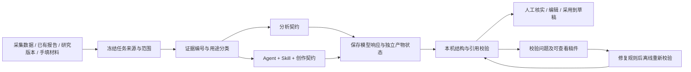

# 以完整来源为核心的分析与创作布局

2026-10-27。本轮在用户授权下直接在本机实施。本文记录当前实现与后续边界，补充并更新 `CREATION_CITATIONS_AND_DRAFT_LAYOUT.md` 中旧版的证据数量和截断策略。

## 结论与根因

主流程应是：选择并冻结来源 → 分析结果 → 根据目标创作 → 校验与人工复核 → 采用到草稿。

持续失败来自几层契约混在一个“模型报告”里：数据创作被要求填写单条内容的固定拆解维度；上游引用与新任务引用不一致；统计摘要替代了原始记录；评论主题频次引用了本机统计，却被只接受评论原文的规则拒绝。单纯更换模型或反复重试无法解决这些问题。

本次将证据分类、输出契约和产物状态分开。严格限制未知引用，同时接受与结论类型匹配的统计依据。结构与引用通过仅表示可以继续编辑和复核，不代表事实已经由模型核实。

## 已实施的四层调整

### 1. 来源层：任务保存完整来源，而非仅保存摘要

- 数据分析创作在同一 SQLite 读取事务中冻结筛选条件、完整分析结果、所选内容正文和所有关联的已保存评论。原始记录与模型输出分开保存。
- 报告创作保留上游完整报告、证据、原来源快照与已有转写；导入证据统一使用新任务的 R 编号，原编号留作来源追溯。
- 数据分析证据使用 A 编号，正文使用 D 编号，评论使用 C 编号。引用可展开对应的完整记录，也可分页查看和下载完整来源包。
- 旧任务若只保存统计摘要，明确显示历史数据缺口。不能将今天的数据库数据冒充旧任务的历史快照；按原筛选新建任务时重新冻结来源。
- 数据来源打包上限为 5,000 条内容、50,000 条评论和 20MB；完整创作输入文本上限为 120,000 字符。超过上限明确拒绝并要求缩小范围，不静默截取一部分后声称完整。模型自身的上下文窗口仍可能小于该应用上限。

这里的“完整”指本机已保存、当前筛选纳入的记录，不表示平台上所有内容或评论。单条原文分析仍使用已披露的评论抽样范围，完整来源包也不补造此前未采集的数据。

### 2. 证据层：按照用途校验，禁止混用依据

| 证据 | 可支持的内容 | 约束 |
| --- | --- | --- |
| 原正文、转写、用户材料 | 来源中记录的事实、创作细节 | 用户陈述仍需人工核实 |
| 原始评论 | 样本中的问题、顾虑与原文观察 | 不把评论者说法写成已核实事实 |
| 本机评论统计 | 本次范围的主题频次等统计结论 | 保留范围、方法；不能推断全体观众比例 |
| 内容统计 | 所选内容的统计描述 | 不能单独支持评论结论 |
| 上游分析结果 | 研究线索、分析结论、创作方向 | 推断与原始证据分开 |
| 写作要求、账号画像、Skill | 表达方式与生成目标 | 不能作为评论或内容事实依据 |

证据用途由应用根据来源类型计算。模型填写的依据标签不作为授权；后台重新计算评论结论是原文、统计还是混合依据。未知编号、无关类型引用仍然拒绝。上游统计经过引用迁移后保持统计用途。

### 3. 产物层：分析与创作分别满足契约

- 单条内容分析保留明确的拆解要求；独立创作使用创作契约，不强迫数据洞察或手填素材生成四个单条拆解维度。
- 创作仍要求完整标题选项、正文、来源、框架和核实项；脚本 Agent 还要求口播开头与分段脚本。
- 任务详情分别展示来源、分析、创作、校验四类状态。完整报告校验失败时，单独检查格式和来源有效的稿件可供查看，并清楚标记“待核对”；不会自动采用到草稿。
- 结构/引用校验与人工事实复核分开。通过前者后，用户仍负责核实事实并决定采用版本。

这是一轮兼容现有任务结构的拆分：产物状态与独立稿件校验已经落地，分析与写作目前仍可由一次模型响应产生，尚未改造成两个独立调度的任务。

### 4. 执行层：先恢复已有产物，再决定是否付费生成

- Schema 字段错误显示具体路径和错误类型，不暴露输入或密钥；已解析但校验失败的模型响应以本机私有文件保留，方便诊断和离线处理。
- “重新校验已保存响应”不调用模型，验证响应的证据 SHA256 与任务当前证据完全一致，再执行结构与引用校验。更新前再次检查状态与证据版本，避免覆盖正在运行的任务。
- 恢复保留原模型、原提示词版本、原生成时间和已记录用量，另记本机恢复时间；重复恢复具有幂等性。
- “从检查点重试”属于可能重新调用模型的操作，与离线重新校验分开。历史任务没有保存响应时，无法凭空恢复那次生成。

## 产品布局与下一步优先级

现有入口按职责组织：采集负责获得资料，数据分析负责统计，AI 内容分析负责理解与结果检索，创作负责选择来源、Agent、Skill 与编辑采用。创作来源统一支持分析报告、研究版本、数据分析筛选和手填材料。每个结果都应直接通向来源和创作，不依赖用户从长表单中寻找产物。

本轮已完成结果检索、完整来源查看、创作来源选择、产物状态与离线恢复。后续应按以下顺序演进，不先扩大 Agent 数量：

1. **拆分任务调度**：分析结果和创作版本分别运行、独立重试。只改语气或标题时复用冻结的分析结果和证据，避免重跑采集、转写或分析。
2. **处理大范围资料**：增加分批提取、分层索引和来源覆盖清单。完整档案长期保留，模型只读取明确披露的工作集；不能用未披露抽样规避上下文限制。
3. **按失败类型评估**：用固定本机样例记录格式通过率、引用类型错误、完整来源覆盖、恢复成功率、单次采用成本。将规则误拒绝、模型输出错误、来源缺失分别计数。
4. **扩展 Agent 与 Skill 注册**：在稳定契约上增加版本和兼容性检查。现有为内置、可选择的 Agent 与 Skill；尚不支持任意外部 Agent 或执行外部 Skill 脚本。

## 验收原则

统计引用与原文引用分别通过相应校验；未知/无关引用仍被拦截；更改来源后拒绝旧响应恢复；恢复不产生模型网络请求；完整来源下载保留筛选尾部记录；旧摘要任务不伪造历史数据；可查看稿件不因其他产物校验失败而丢失；采用操作继续遵守版本保护。

对应回归包括 `test_evidence_artifact_recovery.py`、`test_creation_sources_and_contract.py`、`test_creation_citations.py`、`test_source_archive_browser.py` 及现有完整工作台检查。测试使用独立数据库与本机模型替身，不进行真实采集或发布。
