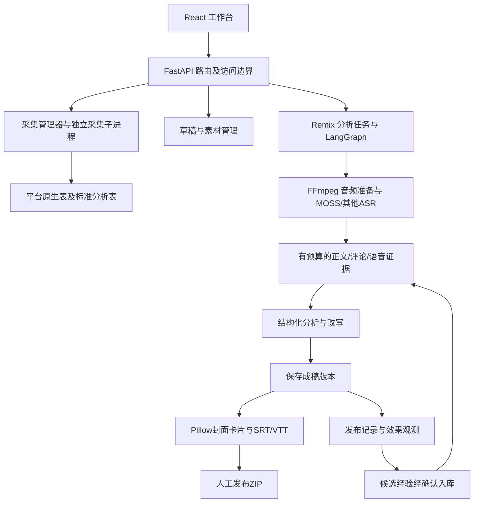

# MediaCrawler 内容生产架构审阅与外部方案调研

调研日期：2026年10月26日（Asia/Shanghai）。本地审阅基线：`736f4dd1bd72799d5f9db197a361875d336c1024`。

## 1. 结论与决策建议

当前项目已从采集器扩展为“采集、分析、改写、模板制图、字幕交付、人工发布交接和手工复盘”的本地工作台。但生产链仍围绕一条采集内容的分析任务展开：素材、草稿、成稿、制作版本和发布结果各有入口，尚未形成以内容项目为核心的连续工作流。

**建议下一阶段把它发展为内容项目中枢：统一资料与版本，补上真实素材驱动的图文和视频制作；成熟编辑器或付费API作为可替换的制作工具。** 保留现有FastAPI、React、SQLite和LangGraph，不整套移植其他Agent平台，也不优先重做完整非线性视频编辑器。

推荐推进顺序：

1. 统一内容项目、资产索引、事实与版本关系，并补齐草稿恢复、备份和回归入口。
2. 打通素材库到封面/卡片，提供适合真实场景的品牌模板和按页面目的组织的图文计划。
3. 用共享分镜计划接通自有录音或TTS、字幕对齐、基础1080p成片渲染和导出。
4. 用真实制作样本比较自建与付费工具，再决定是否深化Remotion、Canva或云渲染集成。
5. 将实际发布绑定到具体文案、封面、字幕、视频和模板版本，逐步形成有支持样本与反例的账号经验。

本次为源码静态审阅、公开仓库与厂商官方文档调研，另进行了本机工具能力枚举。没有购买软件、安装新依赖、修改应用代码、触发真实采集/付费模型/发布，也没有独立运行外部项目或比较其实际生成质量。文中性能改进均为待验证方案，不将文档宣传、Stars或示例视频视为本机验收。

### 前置事项：现有项目许可

本仓库根目录以及当前上游使用 **NON-COMMERCIAL LEARNING LICENSE 1.1**，其中限制未获书面同意的商业用途。若目标包含经营性内容生产、付费服务或产品销售，应先核对已有授权、取得相应许可，或评估独立实现及合法数据接入路线。拆分服务、购买第三方会员或给新增文件换许可证，并不会自动改变既有代码的许可条件。本报告不判断具体业务已获授权与否。[本地基线许可](https://github.com/Stephen240213/MediaCrawler/blob/736f4dd1bd72799d5f9db197a361875d336c1024/LICENSE)、[上游许可](https://github.com/NanmiCoder/MediaCrawler/blob/main/LICENSE)

## 2. 当前实际架构

图中连接表示已有主要调用关系，不表示草稿、素材、图像和视频之间已经双向打通。

### 技术与运行层

| 层 | 当前实现 | 判断 |
|---|---|---|
| 采集核心 | Python、平台Crawler/Store工厂、Playwright/CDP、多种存储适配 | 可继续作为独立采集能力；内容生产不应直接依赖各平台原生表结构 |
| API | FastAPI、路由服务分离、采集子进程管理 | 适合当前单机与小规模使用，暂不需要微服务重构 |
| 前端 | React 18、TypeScript、Vite、React Query、Zustand | 技术栈足够；主要问题是业务入口和编辑状态的组织 |
| 分析编排 | 固定LangGraph节点、SQLite检查点、任务租约、人工重试、缓存 | 已有恢复基础，应扩展阶段产物依赖，而非改成无限工具调用 |
| 媒体处理 | FFmpeg、Pillow、BaoCut worker/MLX MOSS适配，另有whisper.cpp和云ASR入口 | ASR与静态图交付已有基础，尚缺新视频的生产链 |
| 存储 | 采集SQLite、workbench.sqlite3、analysis.sqlite3、checkpoints.sqlite3，以及本机文件 | 数据库分工合理，但资产索引、关联与备份需要统一 |
| 访问与运维 | 正式启动器使用回环监听；远程入口有JWT、角色、CSRF、审计，桌面服务与隧道分管 | 保留已有边界；不要误把直接运行api.main等同正式安全启动方式 |

源码入口：[采集工厂](https://github.com/Stephen240213/MediaCrawler/blob/736f4dd1bd72799d5f9db197a361875d336c1024/main.py)、[工作台导航](https://github.com/Stephen240213/MediaCrawler/blob/736f4dd1bd72799d5f9db197a361875d336c1024/webui/src/components/workbench/Workbench.tsx)、[正式监听入口](https://github.com/Stephen240213/MediaCrawler/blob/736f4dd1bd72799d5f9db197a361875d336c1024/api/serve.py)、[分析工作流](https://github.com/Stephen240213/MediaCrawler/blob/736f4dd1bd72799d5f9db197a361875d336c1024/api/services/remix/workflow.py)。

### 功能盘点：已有与未完成的边界

| 环节 | 当前已有 | 对高效生产仍缺什么 |
|---|---|---|
| 素材发现 | 多平台采集、搜索筛选、评论、数据导入与统计 | 选题池、去重的选题簇、系列内容计划、跨资料汇总 |
| 采集分析 | 标准化互动/时间字段、历史快照、关键词和评论统计 | 采集结果与创作项目的长期关联；曝光、留存等真实后台指标接入 |
| 内容理解 | 小红书正文、上传视频语音、评论引用 | 通用内容Source适配器、图片/OCR、关键帧与视觉理解；当前不是视频画面分析 |
| 文案 | 需求、账号画像、四类框架、多标题、完整改写和人工版本 | 原创项目入口、多来源事实整合、系列选题与共享内容计划 |
| 经验 | 账号作用域、显式通用经验、人工确认和版本快照 | 主题近义匹配、支持/反对样本、适用条件和复查/失效状态 |
| 素材库 | 图片导入、图片/视频预览和归档、配图用于草稿 | 文件哈希、缩略图、标签、镜头索引、权利信息，以及向制作器供图 |
| 图文制作 | 三种风格、三种尺寸、封面和最多8张卡片、PNG下载 | 自有照片背景、裁切焦点、不同版式、品牌字体与组件、语义分页 |
| 字幕 | 完整原转写载入、手工时间轴、SRT/VTT、原片轨道预览 | 新口播的音文对齐、按阅读节奏分句、剪辑后的时间重映射、成片烧录 |
| 视频制作 | 原片播放、语音转写和镜头建议 | 分镜对象、素材匹配、录音/TTS、时间线、混音、转场、成片渲染 |
| 交付 | 不可变制作版本、摘要校验、文案/图片/字幕ZIP | 视频成品、可选编辑器交换格式、品牌模板复用与项目整体交付 |
| 发布与复盘 | 人工回填、独立观测、同类对照、候选经验入库 | 具体制作版本/封面变体绑定、后台CSV映射、自动识别到期复盘项 |

特别需要区分：采集支持多个平台，不代表Remix分析已经支持同样多的平台；当前Remix来源为小红书与上传视频，画像/发布目标选项较广也不改变这一点。平台代码还存在 `dy`/`douyin`、`bili`/`bilibili` 两套命名，新增适配前应集中映射。[标准平台定义](https://github.com/Stephen240213/MediaCrawler/blob/736f4dd1bd72799d5f9db197a361875d336c1024/database/analytics.py#L16)、[Remix契约](https://github.com/Stephen240213/MediaCrawler/blob/736f4dd1bd72799d5f9db197a361875d336c1024/api/services/remix/schemas.py)

## 3. 源码审阅发现与优化优先级

以下P0/P1表示下一阶段产品与工程优先级，不是漏洞等级。规模风险尚未经大数据量压测。

| 优先级 | 已核实的实现或缺口 | 影响与建议 |
|---|---|---|
| P0 | 没有独立content_project，分析job同时充当创作入口 | 一条成品可能综合多份资料，一份资料也可能产出多个成品。新增项目实体，保留job作为分析执行记录 |
| P0 | DraftStudio、rewrite_versions、production_revisions分别存储；草稿配图来自data目录，制作PNG在.runtime目录 | 编辑稿和最终图文不能自然接力。以引用关系连通，避免重复复制、静默覆盖或重新手填 |
| P0 | 制作DesignPage仅有title/body/eyebrow/footer，render不接受素材ID | 现有真实照片不能进入新封面卡片。先打通素材选择、裁切和图片版式，再扩展生成式插画 |
| P0 | 缺少新视频的配音、分镜与渲染流程 | 字幕文件和原片预览不等于新视频成品。先跑通一种30–60秒生产模式 |
| P0 | 常规cloud-check只运行六个旧测试文件及前端构建，未列入Remix测试 | 之前单独跑过的新功能回归不会自然成为固定质量门槛。按文本/媒体/浏览器分层纳入CI |
| P0 | api.backup.main只备份collection与workbench | 新增分析库、检查点、制作成品和依赖原素材不在统一恢复包中。增加完整备份、清单及恢复演练 |
| P1 | AI分析页一直以2秒间隔读取任务列表与完整选中任务，完成后也不停止 | 长报告与完整转写被反复传输。运行中轮询状态摘要，结束停止；正文按需读取，之后再考虑SSE |
| P1 | 制作编辑依赖组件内存；切换任务会以job key重建组件，切换工作台页面会卸载分析页 | 未保存编辑缺少可靠恢复。建立可恢复的项目草稿，跨页提示，按修订号防止多标签覆盖 |
| P1 | 素材列表每次rglob遍历目录，前端每10秒刷新；没有持久缩略图索引和服务端分页 | 随素材增多会增加磁盘扫描、响应和图片传输。按导入/采集事件更新索引，分页与缩略图分离 |
| P1 | 音频/转写文件按job目录复用；跨job没有以媒体SHA为键的统一ASR缓存 | 相同原片改变brief后新建任务可能重复音频处理/ASR。缓存键包含媒体、ASR/对齐模型及参数指纹 |
| P1 | knowledge检索使用平台和题材精确匹配，最多6条，题材非空时需完全一致 | “租房”和“旅居租房”难以自然召回。先加标签映射与FTS检索，保留账号硬过滤和版本冻结 |
| P1 | 发布记录绑定version_id，没有production_revision_id；效果按文案framework分组 | 无法确认采用了哪张封面、哪种卡片或哪版字幕。先补可追溯字段，避免从效果倒推未记录的创作变量 |
| P1 | 发布复盘逐篇查询观测，保存时扫描发布JSON；多张表只有JSON body且connect中执行建表语句 | 小规模可用，批量后有N+1和索引限制。引入版本化迁移及必要索引，把常用分组字段结构化 |
| P1 | 同类复盘主要比较原始指标，中位数未按同口径曝光标准化；目标比值仅单独展示 | 同账号、相近发布时间仍可能曝光不同。已知且同口径时增加每曝光收藏/咨询等对照，缺分母保留未知，不因此宣称因果 |
| P1 | 事实核查主要为建议文本和整体确认勾选 | 生产场景需要具体claim、来源、核对者、时间和适用范围。确认一次不代表事实永久有效 |

证据：

- [素材扫描及草稿保存](https://github.com/Stephen240213/MediaCrawler/blob/736f4dd1bd72799d5f9db197a361875d336c1024/api/routers/workbench.py#L47)、[草稿编辑器](https://github.com/Stephen240213/MediaCrawler/blob/736f4dd1bd72799d5f9db197a361875d336c1024/webui/src/components/workbench/DraftStudio.tsx)、[制作数据契约](https://github.com/Stephen240213/MediaCrawler/blob/736f4dd1bd72799d5f9db197a361875d336c1024/api/services/remix/schemas.py#L179)。
- [制作器与保存逻辑](https://github.com/Stephen240213/MediaCrawler/blob/736f4dd1bd72799d5f9db197a361875d336c1024/api/services/remix/production.py#L79)、[发布记录及复盘](https://github.com/Stephen240213/MediaCrawler/blob/736f4dd1bd72799d5f9db197a361875d336c1024/api/services/remix/publications.py#L59)。
- [任务轮询](https://github.com/Stephen240213/MediaCrawler/blob/736f4dd1bd72799d5f9db197a361875d336c1024/webui/src/components/workbench/ContentRemixAgent.tsx#L41)、[制作编辑状态](https://github.com/Stephen240213/MediaCrawler/blob/736f4dd1bd72799d5f9db197a361875d336c1024/webui/src/components/workbench/remix-production.tsx#L24)。
- [经验检索](https://github.com/Stephen240213/MediaCrawler/blob/736f4dd1bd72799d5f9db197a361875d336c1024/api/services/remix/knowledge.py#L64)、[数据库连接](https://github.com/Stephen240213/MediaCrawler/blob/736f4dd1bd72799d5f9db197a361875d336c1024/api/services/remix/store.py#L26)、[备份入口](https://github.com/Stephen240213/MediaCrawler/blob/736f4dd1bd72799d5f9db197a361875d336c1024/api/backup.py#L26)、[固定检查脚本](https://github.com/Stephen240213/MediaCrawler/blob/736f4dd1bd72799d5f9db197a361875d336c1024/scripts/cloud-check.sh)。

### 应当保留的设计

现有引用ID、来源快照、画像和经验版本、结构化报告校验、付费调用的显式提交、检查点、固定命令参数、脱敏错误、发布前人工核对，以及缺失指标不当作0的做法，均应保留。优化生产效率不应丢掉这些已有基础。

评论议题目前是关键词多标签；“最新评论候选→去重→预算内取样”是可追溯的规则，但不是代表性抽样。后续可增加分层取样与语义候选分类，模型只提出可核对标签，样本计数仍由代码完成。经验检索和规则归类不等于模型微调。[评论取样与证据预算](https://github.com/Stephen240213/MediaCrawler/blob/736f4dd1bd72799d5f9db197a361875d336c1024/api/services/remix/context.py#L16)

## 4. 本机环境核对：不需要先重装整套环境

本次只读检测得到Python 3.11.17、Node 22.23.4。FFmpeg实际枚举包含H.264/HEVC/ProRes VideoToolbox编码器，以及overlay、concat、amix、loudnorm、scale滤镜；**未列出subtitles、ass和drawtext滤镜**。

因此：

- 原有音频准备、PNG绘制和SRT/VTT文件生成可以继续使用现有环境。
- 下一轮若计划直接使用FFmpeg烧录字幕/绘制文字，需要先解决对应构建能力；不能凭“已安装FFmpeg”就认定整条视频生产环境就绪。官方源码明确说明subtitles/ass依赖libass。[FFmpeg官方配置说明](https://github.com/FFmpeg/FFmpeg/blob/master/configure)
- 方案一是由已有Pillow/未来Remotion渲染文字画面，再交FFmpeg混合编码；方案二是为本项目指定独立、固定版本且含所需滤镜的FFmpeg二进制。选择前用小样本比较，不直接替换多项目共用的全局FFmpeg。
- 枚举出硬件编码器不代表实际素材一定走硬件或速度已达标；编解码、转场和浏览器渲染可能各有瓶颈，必须用真实素材测时。
- 继续复用已验证的MOSS/BaoCut worker，不为接入视频生产重复安装ASR或下载权重。worker属于外部应用依赖，应记录版本/接口并保留替换入口。

## 5. GitHub项目：借鉴什么，如何接入

除下列注明的文档/源码阅读外，没有执行这些项目的安装脚本或示例。许可证名称为本次读取结果，实际移植仍需核对选定文件、版本和依赖。

| 项目 | 核对能力 | 对本项目的接入方式 | 判断及限制 |
|---|---|---|---|
| [Easel](https://github.com/ZJU-REAL/Easel) | 画像、技能、内容产物清单、人工发布交接与复盘；Apache-2.0 | 借鉴项目/产物依赖与阶段交接设计，沿用当前SQLite和LangGraph | 设计参考优先，不复制整个Agent执行底座；此前已有单独审阅 |
| [MoneyPrinterTurbo](https://github.com/harry0703/MoneyPrinterTurbo) | 脚本、素材、配音、字幕、MoviePy/FFmpeg合成；MIT | 选取音频时长驱动的素材编排、字幕及任务产物契约作参考，必要时隔离调用 | 最接近缺失的视频生产链；完整接入会带来多供应商配置与依赖，不应直接替换当前项目 |
| [Remotion](https://github.com/remotion-dev/remotion) | React参数化视频、Player、静帧/视频渲染、可复用组件 | 独立Node渲染适配器；Python下发固定Schema，输出资产清单 | 适合品牌图文和动态卡片统一；需核对特殊许可、字体和渲染资源，不是无条件MIT组件 |
| [OpenTimelineIO](https://github.com/AcademySoftwareFoundation/OpenTimelineIO) | 剪辑时间线交换模型及Python绑定；Apache-2.0 | 作为可选交换层，内部先定义有限的镜头/音轨契约 | 它不是编辑器或渲染器；FCPXML等适配器已分仓，不能承诺所有特效往返保真 |
| [Auto-Editor](https://github.com/WyattBlue/auto-editor) | 音量/运动分析的初剪和编辑器交换文件；Unlicense | 作为可关闭的初剪工具，保存cut list后再渲染 | 适合口播删停顿；音量不等于语义重要性，旅居氛围镜头不宜默认删静音 |
| [pyVideoTrans](https://github.com/jianchang512/pyvideotrans) | ASR、翻译、配音、音画同步、CLI及阶段人工校对；GPLv3 | 先学习阶段人工校对与对齐方法；如使用，做隔离试验并核对分发许可 | 适合多语言版本；不宜把GUI、依赖和全部ASR方案塞进现有服务 |
| [pyJianYingDraft](https://github.com/GuanYixuan/pyJianYingDraft) | 生成剪映轨道、字幕与草稿；Apache-2.0 | 可选实验性导出器，不作为当前Mac生产主路径 | 官方README明确Mac不支持自动导出，生成草稿仍需Windows版导出；新版模板读取和自动导出有额外限制 |
| [OpenCut](https://github.com/OpenCut-app/OpenCut) | 主仓库正在重写，规划Rust核心、Editor API、插件、Headless；MIT | 跟踪架构，必要时单独评估classic版本 | 当前主仓库的规划不等于已交付API；不宜现在承诺将其嵌入就能获得成熟编辑器 |

关键源码/文档：

- MoneyPrinterTurbo [video.py](https://github.com/harry0703/MoneyPrinterTurbo/blob/40d7f3de9d8e14056c72f523ecbb6700cff50372/app/services/video.py)、[task.py](https://github.com/harry0703/MoneyPrinterTurbo/blob/40d7f3de9d8e14056c72f523ecbb6700cff50372/app/services/task.py)。可参考其媒体对象、并发边界和生产/发布任务分离；README内赞助供应商宣传不作为质量或费用事实。
- Remotion [README](https://github.com/remotion-dev/remotion/blob/65ce99e14bb0509bc75a562bfd453aa5941c18a6/README.md)、[许可](https://github.com/remotion-dev/remotion/blob/65ce99e14bb0509bc75a562bfd453aa5941c18a6/packages/core/LICENSE.md)。
- OpenTimelineIO [交换格式与插件说明](https://github.com/AcademySoftwareFoundation/OpenTimelineIO#adapter-plugins)、[许可](https://github.com/AcademySoftwareFoundation/OpenTimelineIO/blob/main/LICENSE.txt)。
- Auto-Editor [初剪和交换格式](https://github.com/WyattBlue/auto-editor#exporting-to-editors)、[许可](https://github.com/WyattBlue/auto-editor/blob/master/LICENSE)。
- pyVideoTrans [流程与部署说明](https://github.com/jianchang512/pyvideotrans/blob/a52eeee4fd97ea781de6b986c065dabe86d621d5/README.md)、[许可](https://github.com/jianchang512/pyvideotrans/blob/main/LICENSE)。其Mac部署说明涉及改变全局FFmpeg，不应直接照抄到当前共用工具环境。
- pyJianYingDraft [平台/版本限制](https://github.com/GuanYixuan/pyJianYingDraft/blob/1e228479dda361e312e85f6037002346cf6dca9a/README.md#跨平台兼容性)。
- OpenCut [当前重写状态](https://github.com/OpenCut-app/OpenCut/blob/e668010778568641babef2cc40be4703ae6916d6/README.md#status)。

## 6. 付费软件和API：按瓶颈选工具

| 工具 | 本次核对到的能力/接口 | 建议用法 | 费用、数据与接入边界 |
|---|---|---|---|
| 剪映专业版 | 官方展示字幕、朗读、素材、音频及多轨剪辑能力 | 中文视频的人工精修与成片交付工具；先交换媒体/SRT，再回收成品版本 | 会员和素材权益按客户端确认；未核实可供本项目使用的稳定官方桌面自动化导出API |
| Canva | 官方Autofill及Export API，可填充设计/品牌模板 | 可选高级图文适配器；工作台保存内容计划和版本，Canva负责视觉编辑/导出 | 当前国际版文档已支持Pro等方案，不能沿用“仅Enterprise”旧结论；可画中国账号/区域/API权益需另核实 |
| Descript | 官方API可导入媒体并交Underlord编辑，具有异步任务与编辑器复核入口 | 口播/访谈的文本式编辑候选，先做独立工作流验证 | 付费方案内消耗AI credits/media minutes；官网FAQ对直接媒体导出存在相互冲突措辞，不能当作已验证无人值守后端 |
| OpusClip | 长视频切短片、重构画幅、字幕、编辑器交换；部分方案有API | 仅在经常处理长访谈/长口播时优先试用 | 官方表列Starter月付15美元、150积分；Pro页面同时列月付29美元与年付174美元，别混淆折算价；API有套餐限制 |
| Creatomate | 模板/JSON驱动图像与视频渲染、异步查询或Webhook | 想减少自建渲染维护时，作为独立云渲染适配器 | 积分按像素量等计；成品托管有期限，需及时回存；公开价格页金额未稳定提取，不采信第三方报价作采购依据 |
| 阿里云IMS | 官方时间线合成接口，支持视频/图片/音频/字幕组合与任务查询 | 有国内云端批量合成需求时，与Creatomate二选一比较 | 需核对实际区域、OSS权限、存储/合成费用；本机127.0.0.1素材不能直接交给云端抓取 |
| ElevenLabs | 官方TTS返回音频及字符级时间对齐 | 可选TTS提供者，解决新文稿配音与字幕时间来源 | 中文专有词、费用及声线效果需样本实测；不要默认免费或所有方案均具备零留存；接入前核对音色使用条件 |

来源：[剪映官网](https://www.jianying.com/)、[Canva Autofill](https://www.canva.dev/docs/apps/rest-apis/reference/autofills/)、[Canva Export](https://www.canva.dev/docs/apps/rest-apis/reference/exports/create-design-export-job/)、[Descript API](https://help.descript.com/developers)、[Descript FAQ](https://www.descript.com/api)、[OpusClip方案](https://www.opus.pro/pricing)、[Creatomate API](https://creatomate.com/docs/fundamentals/getting-started/api-automation)、[Creatomate计费](https://creatomate.com/docs/account/how-are-credits-calculated)、[Creatomate价格/保留期](https://creatomate.com/pricing)、[IMS云剪辑](https://www.alibabacloud.com/help/en/ims/user-guide/cloud-clip)、[TTS时间戳接口](https://elevenlabs.io/docs/zh/api-reference/text-to-speech/convert-with-timestamps)。

### 采购判断

先不要同时订阅多个重叠工具。优先选择“一个主编辑器 + 可选一个设计工具”，仅在数据证明云端合成或长视频切片能节省足够人工时间后再购买API方案。付费不等于一定比本机快，也不意味着中国平台发布、中文效果和当前账号权限已经验收。

可采用三条路线：

| 路线 | 组合 | 适用情况 | 取舍 |
|---|---|---|---|
| 立即提高人工效率 | 当前工作台 + 素材/SRT交接 + 剪映；复杂图文按需使用Canva | 希望尽快稳定出内容，仍愿意人工精修 | 新研发较少，但文件交接与版本回收必须做好 |
| 推荐长期路线 | 项目中枢 + 本机模板 + FFmpeg基础渲染；需要时加Remotion；编辑器精修兜底 | 内容形式较稳定，重视本机资料与可控成本 | 维护模板和渲染测试，逐步减少重复劳动 |
| 云端批量生产 | 项目中枢 + Creatomate或IMS + 一家TTS | 产量稳定增长，团队接受上传自有素材并承担按量费用 | 实现回调、幂等、成本上限、结果回存与过期链接处理 |

## 7. 建议的新产品结构

导航建议围绕工作对象组织：**内容项目、选题与资料、素材库、品牌模板、发布与复盘、系统任务**。采集作为资料来源之一，AI分析变成项目中的一个步骤，而非所有制作都必须进入的主页面。

创建项目提供三种入口：

- 原创：输入主题、目标受众、已知事实和自有素材，不强制先采集或上传视频。
- 资料整合：选择多篇参考、评论议题与事实，形成新的观点和结构。
- 原片再创作：从自有口播/访谈/实拍视频中选择片段，保留原始时间依据。

统一项目状态可为：资料准备 → 内容计划 → 文稿确认 → 图文/视频制作 → 待核对 → 已导出 → 已发布 → 待复盘。状态应由实际产物和人工操作推进；“已导出”不能跳成“已发布”，失败/待输入属于阶段执行状态，不应覆盖项目本身的创作意图。

### 共享内容计划，一份资料产出两种体裁

以旅居内容为例，先形成“适合谁、费用口径、租期/付款、实地体验、下一步核验”的共享计划。图文可以是封面、费用页、条件页、体验页、行动清单；视频则把相同重点改为开场、对应实拍/示意、口播和结尾。不能把PNG轮播直接等同成熟视频，也不能将同一文案机械按650字切成高质量卡片。

图文应有比较表、问答、清单、时间线、图片大字、数据说明等有限版式。镜头/画面计划要区分真实照片、资料图和示意图；没有证据的场景和价格不要通过AI视觉补成“实况”。

建议“生成整篇”之后允许局部操作：只改标题、只重排第3张卡片、只重新配第2段旁白、只重渲染受影响片段。每个操作显示输入、所用模型/模板、费用是否可能变化以及新旧版本。

## 8. 数据与技术调整方案

保持模块化单体，增量建立以下关系，不立刻把四个SQLite合成一个库，也不为单机先引入Redis、向量数据库或Kubernetes。

| 对象 | 必要字段/关系 | 作用 |
|---|---|---|
| content_project | project_id、profile_id、主题、受众、目标、内容支柱、状态 | 一个创作意图及其多种交付物 |
| project_sources | source_id、原平台ID、来源种类、采集/上传时间、摘要、快照引用 | 多资料引用与可追溯输入 |
| claims | claim_id、表述、来源、核对状态/时间/人员、适用范围、冲突 | 控制事实与待核查内容；人工确认不等于独立验证 |
| media_assets | asset_id、SHA-256、路径、MIME、尺寸/时长、来源、权利记录、缩略图 | 替代路径本身充当长期身份，支持去重和迁移 |
| content_plan/scene_plan | 页/镜头目的、口播、素材引用、时段、裁切、画幅、字幕策略 | 图文与视频共享的语义计划，渲染器无关 |
| artifact_revisions | 类型、来源版本、依赖摘要、模板/渲染器版本、文件清单、状态 | 复用现有制作版本，增加依赖和过期判断 |
| stage_runs/provider_calls | 阶段、输入指纹、attempt、供应商任务ID、用量、错误类别 | 可恢复执行、计费边界和局部重做 |
| publications/observations | 追加project、production、video、cover_variant等版本引用 | 把效果绑定到实际发布的产物，而非仅绑定文稿 |

新增字段、表与索引采用显式迁移和兼容默认值；历史job、经验、成稿、已导出包均不覆盖。账号仍是内容/经验作用域，现有operator/viewer并不等于多租户隔离，不能把同一项目工具宣称为独立客户数据空间。

### 视频时间与字幕是关键契约

1. 输入素材保留原始时基；剪辑、裁切、变速之后维护原时间到输出时间的映射。
2. 内部片段时间用明确单位的整数或有理帧率表达，避免多次浮点舍入累计。
3. 对“新文稿+TTS”，时间轴来自真实生成音频的对齐结果；没有对齐能力时，对生成音频做ASR/强制对齐并人工检查。
4. 对“原片切短”，将原字幕通过cut list映射到输出时间；删除、重排、加速片段后不能直接复用原SRT。
5. 保存音频SHA、文稿版本、对齐版本与字幕版本；文稿/音频变化使依赖字幕过期，不能只清除一个勾选框。

### 执行器和外部适配器

保留LangGraph编排，但把耗时渲染放受控子进程，先以一个本机重媒体任务并发起步，单独限制网络模型调用并发。后续并发值根据内存峰值、取消行为和真实耗时调整。不要把“多开线程”当作M5上的通用加速结论。

外部工具统一实现能力检查、提交、查询、取消、取回产物接口，明确每项是否支持。付费任务超时进入“结果待查询”，先通过保存的供应商任务ID确认，不直接重复提交。选择云服务时只传所需且获授权的自有素材，不把本机cookie、签名笔记链接或整个评论库作为媒体接口输入。

Remotion/FFmpeg/云时间线只接收经过Schema校验的计划，不执行模型任意生成的shell或脚本。将制作器与当前React版本解耦，独立锁定Node依赖，避免为了一个视频库直接升级整个前端。

## 9. 如何判断效率真的提升

先跑同一批真实自有/授权素材的前后对照，建议试验集为10篇图文、5条30–60秒视频、2段较长口播，并包含长中文、数字/价格、无配音实拍、不同画幅和缺素材等边界。只是建议验收集，未在本次执行，也不用于证明平台传播因果。

分别记录人工操作分钟数、排队/计算/上传等待、改稿次数、首次可用率、失败恢复率、局部重做比例、每条直接费用、峰值内存与存储。对同一输入做重复运行检查缓存与副作用；用户盲选成品可用性，避免用“自动生成了多少文件”代替质量。

主要验收条件：

- 换页/关闭后能恢复编辑，已有保存版本不被覆盖；一个项目可同时找到图文、视频、来源和发布记录。
- 自有照片能直接进入封面卡片；长中文、数字和边缘裁切无缺字、溢出或错误断句。
- 新视频可以从选定文稿和素材生成，口播/字幕与输出时间一致；无黑尾、错轨和丢音。
- 修改一张卡片或一段旁白，只重做依赖它的产物，不重新采集、下载模型或重复付费调用。
- 中断后能判断完成/失败/待查询，并有可恢复的记录；完整备份能在空目录恢复并验证引用文件。
- 实际发布对应到确定的制作与模板版本；未知推广、曝光或指标不补零，也不输出所谓爆款概率。

### 成本核算

单条成本应包含：文字/视觉模型 + TTS/ASR + 图片/视频素材生成 + 渲染 + 上传/存储 + 人工修订 + 失败重试。会员月费另按实际可用成品分摊，不能用厂商“可生成数量”直接当产能。

例如Creatomate文档定义每积分约一亿像素处理量。按其公布变量估算，一分钟1080×1920、30fps视频约为37.3积分（实际还需按其规则舍入和核对附加项），不能套用720p示例。此为公开计费规则推算，不是本项目已发生账单或采购报价。[官方计费规则](https://creatomate.com/docs/account/how-are-credits-calculated)

本机缓存和硬件编码可减少一部分处理，但不预先承诺“提升几倍”或固定每分钟价格；付费工具也要把上传时间和人工纠错计入。

## 10. 分阶段落地与决策关口

| 阶段 | 建议实施 | 可验收的结果 | 暂不扩大 |
|---|---|---|---|
| 第一轮：连通生产对象 | 内容项目、来源/成稿/制作/发布关联；编辑恢复；素材索引；完整备份；Remix进入固定回归 | 用户从同一项目持续完成创作，不再找不到稿件/成品或丢编辑 | 不重写数据库、不装整套新Agent框架 |
| 第二轮：图文提质 | 照片背景与裁切、品牌样式、5–6种语义版式、页面计划、局部重排；完成一个设计工具的小样本对比 | 能把自有资料做成可发布图文，减少逐页手工排版 | 不先做海量模板库或自动批量发布 |
| 第三轮：基础视频闭环 | 一种主模式的分镜、录音/TTS、字幕对齐、简单转场/混音、1080p成片、任务恢复 | 同一内容计划能交付图文及视频；编辑器可人工精修接力 | 不先做完整多轨编辑器、数字人或大量生成式视频 |
| 第四轮：批量与学习 | 批量变体、后台数据导入、明确的复盘窗口、模板/制作版本对照、经验候选 | 能按实际人工耗时和质量选择自建或付费扩容，经验可查支持/反例 | 不把观察性高表现变成因果结论 |

推荐最近一次开发只选择第一轮与“素材照片进入封面”的最小贯通：项目建立 → 选择自有素材 → 保存文稿 → 生成封面/卡片 → 导出 → 绑定发布记录。待这一条链路实测顺畅，再把同一计划接入视频渲染。

## 11. 调研记录与未确认项

主要公开仓库读取时的HEAD：

| 仓库 | 本次记录的SHA |
|---|---|
| Easel | `5a597e5f3ef5b01098b53f36caf719dd9a32b7bf` |
| MoneyPrinterTurbo | `40d7f3de9d8e14056c72f523ecbb6700cff50372` |
| Remotion | `65ce99e14bb0509bc75a562bfd453aa5941c18a6` |
| pyJianYingDraft | `1e228479dda361e312e85f6037002346cf6dca9a` |
| OpenCut | `e668010778568641babef2cc40be4703ae6916d6` |
| pyVideoTrans | `a52eeee4fd97ea781de6b986c065dabe86d621d5` |

Auto-Editor、OpenTimelineIO及部分许可证按默认分支读取，未固定提交；若决定移植应重新锁定版本。来源只采用项目自身仓库与厂商文档；第三方教程、推广报价和README广告不作为接入成功的证据。

尚待用户实际素材试验：中文成品质量、M5真实渲染耗时、长期任务稳定性、Canva/可画账号区域与API权限、Descript导出闭环、付费供应商的实际账单、当前剪映版本的文件交接和特效保真。未确定这些条件前，不把某个付费产品设为必须依赖。

上一轮204项本地检查证明的是当时功能fixture与构建结果，不是本轮外部竞品实测、负载测试或云部署验收。本轮只新增这份调研报告；没有执行上述改造。
