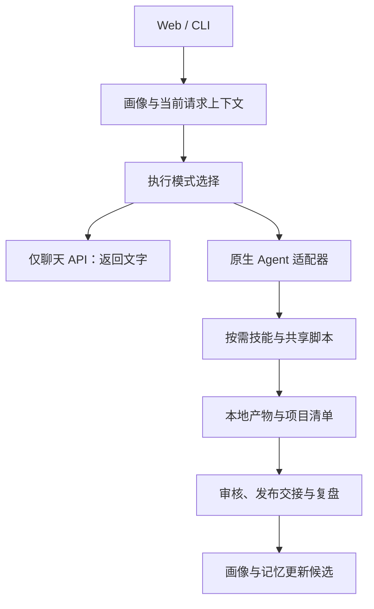

# Easel 项目分析与 MediaCrawler 借鉴方案

调研日期：2026-10-25（Asia/Shanghai）。公开仓库：[ZJU-REAL/Easel](https://github.com/ZJU-REAL/Easel)。本次读取 main 时记录的 HEAD 为 `5a597e5f3ef5b01098b53f36caf719dd9a32b7bf`（2026-10-25 14:24:13 +08:00）。下文基于 README、关键源码、技能说明、测试目录和故障文档的静态审阅；没有安装 Easel、运行其测试、连接其账号或验收真实发布。因此“有实现入口”不等于“所有平台均已独立验证可用”。

## 一、结论

值得借鉴的是“账号上下文 → 专项能力 → 有版本的产物 → 发布记录 → 表现复盘”的组织方式，以及确定性计算、结构化产物契约和恢复机制。它适合作为产品与工程参考，不建议整套替换当前采集器和 ContentRemixAgent。

当前工作台已经具备采集数据、SQLite、LangGraph 检查点、MOSS 转写、评论引用、改写版本与用户确认的经验库。最有价值的增量是：账号级画像、评论议题统计、内容项目与产物管理、同类样本对照、发布结果回填、人工发布包和阶段诊断。

Easel 的“学习”主要体现在文件化画像、记忆和内容复盘驱动的后续提示，不应理解成已经实现模型微调、强化学习或经实验验证的爆款预测系统。

## 二、项目定位与功能核对

README 将产品组织成发现、策划、创作、发布、归因五层。本次读取到 `skills/builtin/` 下115个技能目录；这是目录数量，不是独立验收过的115种生产能力。[README](https://github.com/ZJU-REAL/Easel/blob/5a597e5f3ef5b01098b53f36caf719dd9a32b7bf/README.md)、[技能目录](https://github.com/ZJU-REAL/Easel/tree/5a597e5f3ef5b01098b53f36caf719dd9a32b7bf/skills/builtin)

| 能力 | 核对到的实现或契约 | 当前项目的借鉴价值 |
|---|---|---|
| 账号画像 | 身份、风格、受众、平台、偏好、记忆六类 Markdown；CLI/Web 共享画像工具 | 多账号或不同内容定位的上下文隔离 |
| 热点与选题 | Web 热榜入口、选题和日历接口，多个研究与策划技能 | 从任意改写升级为有目标的选题池 |
| 评论洞察 | 分词、情感近似值、诉求规则和代表评论脚本 | 可复现的计数配合模型解释 |
| 多条内容复盘 | 分组、排序、阈值、交叉比较和样本警告脚本 | 为经验提供样本依据，补足单条分析局限 |
| 图文与媒体制作 | 卡片、语音、字幕、剪辑、视频等脚本入口 | 将正文稿转换为可交付的内容包 |
| 发布 | 平台专用脚本、发布状态、人工包导出和策略开关 | 先借鉴人工交付，再评估平台适配 |
| 产物管理 | 项目清单、上下游步骤、成品与中间件分离 | 追溯某篇文案、图片、视频使用的来源和版本 |
| 交互恢复 | SSE 事件持久化、会话绑定和原生执行器适配 | 页面关闭不等于任务终止，重连可回放 |

这张表是“存在相关实现/契约”的核对，不将文案列举直接视为全面可用。以下分别说明重要机制。

## 三、功能上最值得借鉴的部分

### 1. 账号画像从单次需求中独立出来

`easel/persona.py` 统一画像加载和消息构建；每次请求绑定具体画像，减少不同账号共享全局记忆引起的串用。其模板把相对稳定的定位与风格、可变化的受众认识、平台策略和经验分开。[persona.py](https://github.com/ZJU-REAL/Easel/blob/5a597e5f3ef5b01098b53f36caf719dd9a32b7bf/easel/persona.py)、[画像模板](https://github.com/ZJU-REAL/Easel/tree/5a597e5f3ef5b01098b53f36caf719dd9a32b7bf/profiles/_template)

建议为当前项目增加 `creator_profiles`：画像ID、定位、目标受众、语气、内容支柱、禁用表达、适用平台及版本。每个分析任务冻结画像版本；单次 brief 仅覆盖这次任务，不能暗改长期画像。经验库增加 profile_id，保留当前人工确认与历史快照。

不必直接改成 Markdown 存储。当前 SQLite 更适合页面编辑、并发检查、审计和关联查询；可提供 Markdown 导入导出。

### 2. 评论“算什么”和“解释什么”分工

Easel 的评论脚本输出高频词、短语、需求、疑问、吐槽计数以及代表样本。情感使用 SnowNLP 加词典修正，并在技能说明中承认近似性质。[评论脚本](https://github.com/ZJU-REAL/Easel/blob/5a597e5f3ef5b01098b53f36caf719dd9a32b7bf/skills/builtin/skill-comment-insights/scripts/comment_insights.py)

建议保留本项目的评论ID与引用体系，增加“议题 → 样本数 → 代表引用 → 应补信息 → 改写动作”。数量与覆盖率由代码计算；模型归纳问题、区分明确咨询与模糊情绪，不能凭感觉生成百分比。

不宜直接将通用情感分数当成真实满意度。该脚本的词典修正使用词语子串命中，否定、反讽和领域表达仍需复核。对交易或服务类内容，费用、门槛、体验问题、咨询意向等议题通常比单一正负情绪更有行动价值。这是面向当前产品的设计建议，不是已经验证的效果结论。

### 3. 多样本复盘替代单条“爆款公式”断言

`aggregate.py` 将排名、分组和交叉统计放在代码中；模型读取统计结果做解释。这比要求模型心算更可检查。[聚合脚本](https://github.com/ZJU-REAL/Easel/blob/5a597e5f3ef5b01098b53f36caf719dd9a32b7bf/skills/builtin/skill-content-postmortem/scripts/aggregate.py)

当前项目可按相同平台、账号、题材、发布时间窗口和内容年龄建立对照，优先比较收藏、咨询或其他与目标相符的指标。结果进入“候选经验”，经人工确认后启用，记录支持和反对样本。

需调整其默认统计口径：综合分使用固定权重，并把部分缺失值视为零；不同平台和目标不宜直接共享这一评分。代码中的 `lift_vs_global` 是组均分相对全体均分的变化，不是因果提升，也不是下一篇内容的爆款概率。少量样本、分位分组和事后筛选都不足以证明可复制因果。[公共统计函数](https://github.com/ZJU-REAL/Easel/blob/5a597e5f3ef5b01098b53f36caf719dd9a32b7bf/skills/shared/scripts/social_stats.py)

### 4. 内容项目与结构化产物清单

`manifest.py` 用项目清单记录体裁、平台、交付物、步骤、来源产物和状态，使多个制作环节通过明确对象交接，而不是依赖聊天记录。[manifest.py](https://github.com/ZJU-REAL/Easel/blob/5a597e5f3ef5b01098b53f36caf719dd9a32b7bf/skills/shared/scripts/manifest.py)

建议在现有 job 与 rewrite_version 上增加 content_project/artifact：正文、封面、卡片、口播、字幕、视频均有独立版本和来源；修改文案时只将依赖它的产物标记过期。最终交付物与原素材、中间文件分开显示。保持 SQLite 作为关系真相源，文件内容放本地目录。

### 5. 人工发布包比直接接自动发布更适合当前阶段

`manual_publish.py` 实际实现了审核后导出标题、正文、标签、媒体、清单及平台入口的本地压缩包；导出状态与已发布状态分开。[人工发布包实现](https://github.com/ZJU-REAL/Easel/blob/5a597e5f3ef5b01098b53f36caf719dd9a32b7bf/easel/manual_publish.py)

可先为当前采用稿增加预览和导出包，再由用户到官方页面提交并回填作品链接。未来如接发布适配器，必须单独设计请求幂等、结果查询、状态未知和账号校验；不能把网络失败解释成没有发布，然后自动再次提交。

注意 Easel 当前 `publishing_mode` 的空配置默认值仍是自动模式；人工模式需要配置。不能因为存在人工发布功能，就声称其默认禁止自动发布。

### 6. 日历、选题池与实际调度分开

Web 日历接口保存计划与状态；独立 scheduler 技能计算到期项，实际发布交给各平台脚本，常驻触发依赖上层执行器或系统调度。[调度技能说明](https://github.com/ZJU-REAL/Easel/blob/5a597e5f3ef5b01098b53f36caf719dd9a32b7bf/skills/builtin/skill-publish-scheduler/SKILL.md)

可借鉴选题→草稿→待核实→待发→已发→待复盘的状态流，但“填了发布时间”不能等同“有可靠定时执行”。当前阶段优先做计划管理和人工确认，不扩大真实发布范围。

## 四、技术架构与工程借鉴

### 技术栈

- 后端为 Python/FastAPI/Uvicorn；HTTP使用 httpx，消息使用 SSE；浏览器集成为 Playwright，媒体处理使用 FFmpeg 与多个专项库。
- 前端 package.json 为 React 19、TypeScript 6、Vite 8，包含 Markdown 渲染及 DOMPurify。
- 执行器包括仅聊天 API 模式和多个原生 Agent 适配器；适配层统一 RunRequest、事件、问答和会话绑定。

来源：[Python依赖](https://github.com/ZJU-REAL/Easel/blob/5a597e5f3ef5b01098b53f36caf719dd9a32b7bf/pyproject.toml)、[前端依赖](https://github.com/ZJU-REAL/Easel/blob/5a597e5f3ef5b01098b53f36caf719dd9a32b7bf/web/frontend/package.json)、[执行器契约](https://github.com/ZJU-REAL/Easel/blob/5a597e5f3ef5b01098b53f36caf719dd9a32b7bf/easel/harnesses/base.py)

现有 MediaCrawler 的 FastAPI、React、LangGraph、SQLite 与本机工具已经足以逐项实现借鉴能力。无需为此换前端框架或替换任务执行引擎。Easel 当前安装文档要求的 Node 版本高于本项目的 Node 22；若未来试装，应使用隔离环境，不改变现有项目运行时。

### 逻辑结构（依据源码归纳）

这是逻辑归纳，不表示每次请求都会执行全链路；API直连不具备本机工具执行能力。

### 分层提示与按需能力加载

其 prompt-stack 区分人格、业务编排、运行时和按需技能，避免把所有技能正文塞进每次请求。[提示分层](https://github.com/ZJU-REAL/Easel/blob/5a597e5f3ef5b01098b53f36caf719dd9a32b7bf/docs/prompt-stack.md)

建议将本项目逐渐增大的提示词拆成：固定约束、选定账号画像、创作需求、少量匹配经验、所选专项规则、证据。为这些输入记录版本与预算，优先压缩冗余内容，保留来源和截断说明。不要将素材正文或评论升级为可执行指令。

### 执行引擎与模型供应商解耦

原生适配器把工具执行与模型供应商配置分开；API直连则明确没有本机执行工具。[执行器文档](https://github.com/ZJU-REAL/Easel/blob/5a597e5f3ef5b01098b53f36caf719dd9a32b7bf/docs/agent-harnesses.md)、[API直连实现](https://github.com/ZJU-REAL/Easel/blob/5a597e5f3ef5b01098b53f36caf719dd9a32b7bf/easel/direct_api.py)

对本项目的近期价值是统一文本、视觉、ASR适配器及能力探测，保留结构化输入输出与错误分类。暂时不需要赋予内容分析模型任意 shell、浏览器或发布工具；现有固定 LangGraph 流程更容易测试、控制费用和恢复。

### 三种恢复机制不能混同

1. SSE事件日志用于重连回放，避免前端断线被误当成任务取消。
2. 原生会话绑定用于续接同一执行器上下文。
3. 本地产物检查点通过输入指纹、摘要、独占锁与原子提交复用已完成步骤。

来源：[事件日志与接口](https://github.com/ZJU-REAL/Easel/blob/5a597e5f3ef5b01098b53f36caf719dd9a32b7bf/web/app.py)、[会话持久化](https://github.com/ZJU-REAL/Easel/blob/5a597e5f3ef5b01098b53f36caf719dd9a32b7bf/easel/harnesses/store.py)、[产物检查点](https://github.com/ZJU-REAL/Easel/blob/5a597e5f3ef5b01098b53f36caf719dd9a32b7bf/docs/artifact-checkpoints.md)

本项目应继续保留 LangGraph 的持久化工作流，同时为视频、字幕、卡片增加产物摘要与依赖指纹。事件回放不等于后端工作流恢复；本地步骤可重做也不意味着付费请求或发布可安全重发。

### 兼容性探测与故障证据

Easel 提供显式启用的工具协议探测、环境诊断和故障测试报告。探测有请求数量和时限，失败时不暗中换模型或重试；故障报告区分未运行、跳过和通过。[协议探测](https://github.com/ZJU-REAL/Easel/blob/5a597e5f3ef5b01098b53f36caf719dd9a32b7bf/docs/model-tool-probe.md)、[故障评估](https://github.com/ZJU-REAL/Easel/blob/5a597e5f3ef5b01098b53f36caf719dd9a32b7bf/docs/agent-fault-evaluation.md)

当前项目可增加“只读配置检查”与“用户主动触发的小请求验证”两个入口，后者明确会调用模型。应记录请求数、完成原因、结构校验、脱敏错误类型和用量；不要把 HTTP 200 当作报告有效，也不要把一次样本当作稳定成功率。

## 五、需要谨慎对待的部分

1. **能力广不等于闭环质量已验证。** 技能目录、演示产物、测试文件和真实平台验收属于不同证据层级，本次未独立运行 Easel。
2. **学习不等于训练。** 当前可核实的是画像和记忆文件更新、检索上下文与统计复盘，不应宣传为自动训练出的爆款模型。
3. **固定权重不是跨平台统一标准。** 缺失值、内容年龄、曝光分母和投流等因素必须保留并说明。
4. **技能模板可能比证据更强。** 复盘模板含概率化、因果化措辞，但聚合脚本主要提供描述统计；借鉴时应改为条件化假设与后续验证。
5. **服务边界不同。** Web 源码说明其 Origin/Host 防护主要针对浏览器跨站请求，不能替代身份认证；入口仍可监听全部网卡。不要用它替换现有工作台的回环绑定、远程JWT、角色和CSRF边界。[Web边界实现](https://github.com/ZJU-REAL/Easel/blob/5a597e5f3ef5b01098b53f36caf719dd9a32b7bf/web/app.py)
6. **工程复杂度。** 核心 web/app.py 约5684行，承担会话、配置、发布、登录、日历等多种职责；文件化状态也需要分别处理并发。当前项目应按路由与服务拆分，保留SQLite事务，而非整块移植。
7. **规则来源需统一。** 不同人格提示、技能规则与人工发布说明可能存在口径差异。应采用一个版本化策略源，避免多份自然语言规则各自变化。
8. **平台状态需实际核验。** 已知问题文档记录二维码、会话身份、网络和维护页面等边界；不能凭Cookie文件存在或单次页面跳转就确认账号可用。[已知问题](https://github.com/ZJU-REAL/Easel/blob/5a597e5f3ef5b01098b53f36caf719dd9a32b7bf/docs/known-issues.md)

仓库为 Apache-2.0；本次只借鉴设计并撰写分析，没有复制其实现代码。未来若实际移植，应另行核对源文件与第三方依赖的许可和声明。[LICENSE](https://github.com/ZJU-REAL/Easel/blob/5a597e5f3ef5b01098b53f36caf719dd9a32b7bf/LICENSE)

## 六、建议的落地顺序（本次未实施这些新增功能）

| 优先级 | 建议增量 | 验收标准 |
|---|---|---|
| P0 | 账号画像与经验作用域 | 不同账号不串用经验；任务可查画像/经验版本 |
| P0 | 评论议题表与量化覆盖 | 计数由代码完成；每个议题能定位代表评论 |
| P0 | 模型响应诊断与小样本验证入口 | 配置就绪、协议可达、报告有效分别展示，不自动付费重试 |
| P1 | 项目/产物清单 | 文稿、封面、卡片、视频版本可关联与导出 |
| P1 | 人工发布包与结果回填 | 导出不标记已发布；回填链接后才进入复盘 |
| P1 | 同类样本比较和候选经验 | 显示分母、样本数、时间口径和反例；人工确认入库 |
| P2 | 卡片/字幕/视频自动制作 | 输入与产物摘要可核验，局部失败可恢复 |
| P2 | 多平台执行器与发布适配 | 每个平台独立验收、授权、幂等及结果查询 |

建议先做“账号画像＋评论议题＋复盘回填”，其价值与现有工作台最接近。115个技能、多个Agent底座和自动发布都不应成为第一轮移植目标。

## 七、本次另外修复：原小红书链接

问题在于分析任务只拼接笔记ID，未使用采集库中原链接的访问参数。修复为点击报告链接时，通过本机路由读取当前已保存的 note_url/url/xsec_token，校验平台域名与笔记ID后跳转；历史任务无需重新分析。

链接访问参数不进入模型证据、报告缓存或Markdown导出；跳转设置不缓存且不发送来源页信息。测试使用虚拟笔记与浏览器拦截验证参数保留，不访问真实平台。该修复恢复已保存参数的传递，不保证平台已删除内容或过期参数仍可访问；实际登录与平台状态仍由浏览器和平台决定。
