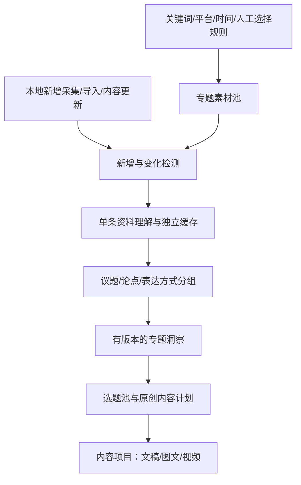

# 从单条改写到专题增量分析：方案调整

评估日期：2026年10月26日。基线：`9fb2804`。本轮只评估和整理方案，未实施代码、自动采集或真实模型调用。

## 1. 为什么当前只能选一条

限制来自目前的任务建模：JobInput只接收一个content_id或upload_id，source_for读取单条正文与评论，报告契约将单条拆解、账号需求与完整改写绑定。现有缓存根据全部证据、模型、服务端点和提示词计算，属于整份输入缓存，不是专题增量索引。

第一轮项目功能解决的是关联与查找：同一项目能看到多个分析任务、成稿和成品，但没有把多条内容转化为专题洞察。数据分析页虽然可以按keyword筛选统计，也没有与AI专题理解连接起来。

这需要调整产品和数据结构，不能只把单选框换成多选框，或将全部素材拼接后每次重新发送模型。

源码依据：[输入契约](https://github.com/Stephen240213/MediaCrawler/blob/9fb2804/api/services/remix/schemas.py)、[来源与缓存](https://github.com/Stephen240213/MediaCrawler/blob/9fb2804/api/services/remix/workflow.py)、[项目汇集](https://github.com/Stephen240213/MediaCrawler/blob/9fb2804/api/services/remix/projects.py)、[关键词筛选](https://github.com/Stephen240213/MediaCrawler/blob/9fb2804/api/services/analytics.py)。

## 2. 新结构：专题素材池 → 可复用分析 → 专题洞察 → 内容项目

建议把「AI内容分析」默认入口改为专题，保留单条深挖作为下钻功能。

四种对象各司其职：

- **专题**是长期研究范围，例如「双月湾旅居」，包含多个关键词、平台和筛选条件。
- **素材**是具体笔记、评论、视频或用户补充材料，保留来源、版本与可访问的证据。
- **专题洞察**综合多份资料，展示共性、分歧、样本依据、未覆盖部分和选题机会。
- **内容项目**负责具体创作交付，例如某一篇「旅居费用核对清单」，引用一个确定的专题洞察版本，并使用账号画像和写作经验。

同一素材可以属于多个专题；同一专题可以支持多个内容项目。无需每个专题复制一遍素材分析，也不应让新增资料直接覆盖已确认文稿或已经发布的内容。

## 3. 关键词如何定义素材范围

专题支持多个关键词、平台、时间口径、图文/视频形式、人工纳入/排除，以及清晰可查看的筛选规则。应区分两种匹配：

1. **采集来源关键词**：这条内容从哪个关键词搜索获得，不要求关键词一定出现在标题。
2. **内容匹配词**：正文或标题中包含什么，支持包含/排除词，是额外规则，不等同于采集来源。

目前analytics_content每条内容只有一个keyword字段，upsert会用较新的值更新它。相同笔记经多个关键词发现时，该字段不足以保留完整关系。因此应新增关键词/采集批次与素材的多对多关联；存量按现有字段初始化，缺失历史关系标记未知，不能凭空恢复。

素材统一按平台+内容ID去重，再根据正文、媒体与评论版本识别变化。不要将collected_at变了、点赞增加或另一个关键词再次发现同一笔记，当成一篇新内容。

自动纳入只针对已经保存到本机的数据；专题分析不自动启动平台采集或绕过现有登录流程。

## 4. 把分析拆成能够独立复用的层

### 4.1 媒体与转写层

以媒体SHA、ASR/对齐模型及参数版本建立独立缓存。同一视频在不同专题、不同创作需求中复用转写。修改标题、账号语气或评论样本，不应重复跑ASR。

### 4.2 素材理解层

保存与具体创作需求分离的结构化结果：核心议题、明确论点及来源、费用/条件等声明、叙事结构、开头方式、表达特点、评论诉求及证据引用。不在首次批量分析时为每条参考笔记同时生成多份完整改写。

缓存必须包含素材语义指纹、分析规则/Schema版本、模型及服务端点等必要条件；变化的互动数字和采集时间不进入正文语义缓存。来源引用使用稳定的素材版本和证据单元ID，不能只靠各单条报告中可能重复的E0001编号。

### 4.3 专题统计与洞察层

计数、去重、时间窗口、指标有效性由代码处理。模型负责解释有依据的共性、分歧和创作机会。评论同时报告覆盖笔记数、保存样本数和实际分析样本数；语义相同问题可归组，但不能因文本去重而抹掉原始出现次数，也不能把机器重复或疑似灌水直接当真实需求量。

专题报告应包含：

- 样本范围、分析覆盖、时间口径、来源分布和未处理项。
- 高频关注议题及跨笔记覆盖情况、代表原文和反例。
- 同一问题的不同说法、事实口径冲突、尚需核实的信息。
- 常见标题、开头、结构和表达方式，说明适用素材和局限。
- 表现较高/较低样本的描述性对照；平台、内容年龄与分母不同不可混排为因果结论。
- 可供账号选用的选题、角度和资料缺口。

### 4.4 账号创作层

只有选定选题、账号与目标后，才生成具体文稿、封面、卡片和视频计划。账号或写作经验变化主要影响创作层，避免令整个素材池重新分析。共享中性资料分析也不能越过现有身份访问边界，不能复用其他账号的专属改写偏好。

## 5. 什么变化触发什么处理

| 变化 | 应执行 | 可复用 |
|---|---|---|
| 新增一篇匹配笔记 | 新素材理解；更新相关议题与洞察 | 原有素材分析 |
| 同一内容再次采集且正文/媒体不变 | 更新采集与关联记录 | 正文理解、ASR |
| 只有互动数变化 | 更新统计；若影响筛选/排名，刷新相关视图或综合 | 正文理解、ASR、评论文本分析 |
| 已有笔记新增评论 | 对未处理评论做归类/提取，更新所属议题 | 已处理评论、正文、ASR |
| 评论文字修改或移除 | 重做/撤回该评论贡献，重算相关议题 | 其他评论和正文 |
| 正文修改 | 创建素材新版本，更新相关分析与分组 | 未变化媒体的ASR、其他素材 |
| 视频文件变化 | 新媒体版本及必要转写 | 无关素材及已确认历史输出 |
| 素材加入另一个专题 | 复用兼容素材分析，更新新专题综合 | 原专题与已有单条结果 |
| 修改专题筛选或时间范围 | 计算成员差异、更新综合 | 仍适用的已有素材分析 |
| 人工排除、来源失效或滚动窗口到期 | 从当前综合中撤回该素材贡献 | 保留历史洞察与创作版本快照 |
| 修改账号语气/经验 | 更新后续创作输入 | 中性素材分析、转写和专题基础统计 |
| 分析策略或模型升级 | 标记旧版本及兼容性，由用户选择重建范围 | 兼容结果、旧版洞察和成品 |

“旧素材不重跑”指内容理解、转写等未受影响的计算复用。新增内容可能改变专题结论，综合层仍需处理受影响的输入，可能产生模型费用，不能宣称整个过程零调用或永远只增加一条固定成本。

## 6. 综合结论如何增量更新而不越积越偏

不应无限循环地把「上一份报告+新增材料」作为唯一事实来源：旧总结可能丢失细节、传播错误，也难以撤回被排除的素材。

推荐保存结构化的素材分析与证据，再按稳定议题分组综合。新增素材通常只改变一个或少数分组；未变化分组复用其结果，专题总览读取最新分组摘要和精确统计。

输入签名应由有效成员的ID、版本、规则和必要参数计算。分组标识保持稳定，避免每新增一条就将全部素材重新分页、导致每一页缓存都失效。出现新议题或跨组冲突时允许有界重分组；提供显式「重新综合」入口及预算提示。

定期质量校正可以从已有结构化结果与原始证据重建综合，优先不重跑底层素材分析。它解决累计摘要偏差，不是对用户隐藏的自动全量重分析。

## 7. 自动纳入与自动付费分析分开配置

推荐先实现：保存专题规则后自动识别本机新增内容、归入素材池，显示待处理队列；点击「仅分析新增与变化」执行本次增量。

随后可以提供专题级「自动增量分析」选项：用户明确授权其发送范围、模型、视频转写策略、每轮条数和预算上限后，在采集/导入批次结束时自动处理，达到上限留在待处理状态。不必每条重复确认，但不能把建立关键词专题等同于无限期付费授权。

执行层应记录：

- 每轮冻结的成员/版本清单，新增、变化、复用、失败和排除数量。
- 输入指纹、阶段状态与兼容缓存命中，而不是只记录一次任务的完成与否。
- 后端变化事件与扫描对账。只靠最后采集时间或行数，可能漏掉旧内容编辑、同数量评论替换和事件丢失。
- 执行期间又到达的资料进入下一轮，当前报告展示实际覆盖范围。
- 单项失败可以继续其他项，报告标明部分完成；未成功分析的素材不计入模型结论覆盖。
- 付费调用失败后的状态与人工重试范围。供应商无查询能力时，应保留结果未知状态，不能把本地幂等键当成绝不重复收费的保证。

不逐条刷新一份昂贵的全专题报告，可在本轮增量处理完成后更新受影响分组与总览，减少调用和结论抖动。

## 8. 页面和操作流程

建议AI内容分析包含四个区域：

1. **专题与范围**：专题名称、关键词组、平台、时间口径、纳入/排除规则。
2. **素材与处理状态**：新增、正文变化、评论增量、指标更新、可复用、失败；允许筛选及手工排除。
3. **专题洞察**：议题、论点冲突、结构模式、描述性对照、选题机会，均可下钻到原素材和具体引用。
4. **选题到创作**：选定角度，创建/关联现有内容项目，使用该账号画像与写作经验生成成稿。

按钮以「更新素材池」「仅分析新增与变化」「更新专题洞察」「单条深挖」区分行为。全量重建放进高级入口，不作为日常默认操作。提交前显示本次处理清单与预算边界；执行后显示实际调用、复用和覆盖情况。

示例：某专题已有80篇且已完成兼容的素材理解，新增10篇后，界面应显示「新增10、可复用80」。执行只处理10篇新增素材及受影响的综合，不再转写或完整拆解原80篇。若旧资料还没有兼容的基础分析，则明确展示初次建立所需范围，不能把“已采集”当成“已分析”。

## 9. 在当前项目中如何落地

建议将专题增量分析前置为下一轮重点，再继续此前计划的视觉提质与视频生产。第一轮项目、恢复、索引和备份可直接复用，无需推倒重建。

| 增量对象 | 职责 |
|---|---|
| topic_spaces/rules | 专题定义、过滤范围和自动处理授权 |
| source_keyword_memberships | 素材与关键词/采集批次的多对多关联 |
| source_versions | 正文、媒体、评论的独立语义版本与摘要 |
| material_analyses | 可复用的中性素材分析及模型/规则版本 |
| comment_contributions | 每个评论版本贡献的标签、计数和证据 |
| topic_memberships | 专题当前纳入/排除及理由 |
| topic_runs/items | 本轮成员快照、阶段、费用、复用与失败状态 |
| topic_clusters/insight_revisions | 稳定分组与可追溯的综合报告版本 |
| project_topic_refs | 内容项目引用确定的专题洞察版本 |

先支持已有小红书素材、正文与评论、手动触发增量；复用现有单机串行执行器。后续再接独立媒体缓存、多平台Source适配及预算内自动处理，不先增加新的任务基础设施。

旧版报告可复用其中可核验的来源证据和转写；账号特定改写保留在创作层。只有来源指纹、规则和结果契约兼容时才直接复用素材理解；缺少字段时明确标注需补齐范围与费用，不一律重跑，也不无条件把旧报告当成通用分析。

## 10. 建议验收标准

- 首次建立专题后再次执行，未变化资料不触发新的ASR或素材理解调用。
- 新增10篇只处理10篇及其受影响综合；重复导入/重试不形成重复贡献。
- 只有互动数或采集时间变化，不触发正文/ASR重分析；筛选成员变化仍准确更新。
- 新评论只新增相应分析贡献，评论编辑、排除或删除能撤回旧贡献。
- 同一素材属于多个关键词/专题仍只保留一份可复用的兼容基础分析。
- 不同账号的专属偏好不会通过共享缓存串入其他账号创作。
- 来源移除、规则变化、策略升级和部分失败均能显示正确覆盖与版本。
- 新洞察不会覆盖已确认文稿、制作文件和发布记录。
- 每轮能解释处理了什么、复用了什么、哪些调用可能收费、还有什么没分析。

这轮调整的核心是让资料理解成为可复用资产，专题洞察持续吸收变化，具体创作按需执行。单条分析继续服务引用核查和深挖，日常入口转向专题。
